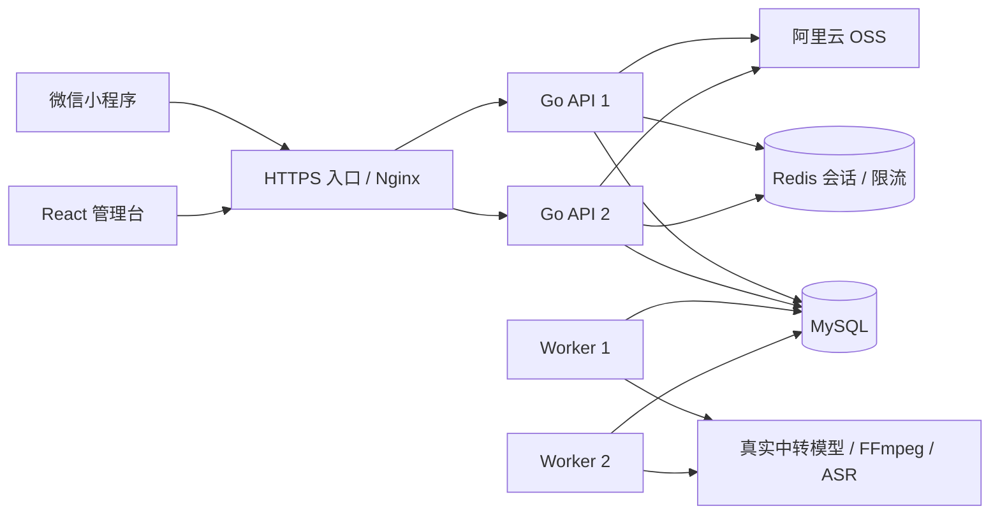

# 部署与并发边界

## 部署拓扑

初期在一台机器运行 Nginx、MySQL、Redis、API 和 Worker。API 和 Worker 分开进程，后续按各自负载扩容；本地为方便联调，默认在 API 进程内运行两个 Worker。当前电脑已接本地 MySQL，Redis 与 OSS 尚待测试环境提供，不能把本地存储模式用于跨主机扩容。

## 持久化

`records` 保存有版本号的模型、模板、用户资料、素材、收藏、反馈、钱包/订单/流水、执行状态、审核与通知，主键为 `(namespace, id)`。JSON 结构由 API/业务服务校验，`owner_id` 用于私有数据隔离。财务状态与任务使用相同的数据库事务接口；流水引用具有唯一性，禁止直接通过通用编辑界面修改账本。

`jobs` 使用独立、可索引的状态、用户、租约和时间字段，不将队列状态藏进 JSON。入参是提交时的快照，管理员后续修改模板不会改写已经提交的任务。

列表目前有明确上限：任务最近 200 条、其他记录最多 500 条。兼容概览 `/admin/overview` 带统计范围说明，新看板 `/admin/dashboard` 根据日期独立统计。支付自动查单按未结算记录与共享游标遍历，不受 UI 列表上限限制。运营历史列表在数据规模扩大后仍需增加服务端分页/归档。

## 重复请求

客户端保存本次提交的幂等键，网络重试沿用。同一用户的同一键对应固定任务 ID，数据库唯一键保证只创建一次。请求正文摘要不一致则返回 409，防止误把新请求当成旧请求。

幂等保障范围是“同一键”；用户主动重新创建、换键、再次点击已完成后的生成按钮，属于新任务。系统没有实现“相同提示词永远只生成一次”这种不符合创作需求的去重。

## 多 Worker 与故障恢复

1. READ COMMITTED 事务中查询最早可处理任务，`FOR UPDATE SKIP LOCKED`。
2. 在同一事务写入 running、随机 lease_token、60 秒 lease_until 和递增 attempts，然后提交。
3. 不持有数据库事务执行 Provider。
4. 完成时执行带状态、令牌、有效期条件的 UPDATE。
5. 进程停止后不提交成功；其他 Worker 等租约过期再领取。旧 Worker 后到的结果被 CAS 条件拒绝。

队列采用 **至少一次领取 + 租约令牌保护回写**，外部生成不能随领取重复提交。持久执行状态先记录 submitting，再调用上游，获得任务编号后转为 polling；后续实例继续查询/保存。提交结果未知时停止自动重发，管理员先核实。混剪的改写/配音子任务有独立确定性执行 ID，同样保留结果与未知状态；耗时步骤续租，临时文件不作为共享状态。

创建任务时锁用户钱包，原子预留积分与插入任务；完成时校验当前租约，原子更新结果、账本、审核与通知。明确失败返还，未知上游状态保留积分待核实。微信支付由官方 SDK 验签解密，商户/AppID/OpenID/金额/币种与订单匹配后才到账；同一交易仅记账一次。退款预留并最终回收/归还相同积分，不能与并发消费造成负余额。

当前无需 Redis 消息队列：MySQL 中的任务表同时充当持久化队列，避免数据库与队列双写。将来引入消息队列时，应使用事务 Outbox，而不是先插任务再直接发消息。

## 会话与权限

- 会话 token 为随机 256 位值，仅散列后的键进入 Redis。
- 管理台 HttpOnly/SameSite Cookie，生产环境 Secure；小程序使用 Bearer token。
- 后台路由严格检查管理员身份；私有任务和素材检查 owner。
- Redis Lua 实现共享限流，Redis 不可用时有状态操作不退回到各节点独立计数。
- 当前管理员身份来自部署配置，适合单运营管理员。已记录积分调整、用户启停与内容审核操作者；多管理员 RBAC 与独立账号生命周期仍为后续扩展。
- 对外应由入口层补充按真实客户端 IP 的访问频率限制，避免代理后的登录限流聚合。

## 存储与运维

MySQL 与 Redis 在多个应用实例间共享，不应为每个 API 容器新建一份数据库。MySQL 持久卷需要备份与恢复演练；Redis 保存会话，丢失会导致重新登录，但任务仍保存在 MySQL。

生产上传与生成结果使用 OSS。原型封面属于随镜像分发的只读静态资源，各实例内容一致；本地预览上传和 FFmpeg 输出不属于跨主机共享资源。

每个 API/Worker 的 MySQL 最大连接数为 20，扩容后总连接数随进程数量增长。应根据数据库容量调整连接池、Worker 数、慢查询索引和调用限流；多实例不等于自动高可用，MySQL/Redis 本身也需独立高可用设计。

上线迁移顺序：备份 → 兼容性 schema migration → 更新应用 → 必要的数据迁移。当前初始 schema 使用 `CREATE TABLE IF NOT EXISTS`，API 不自动迁移。后续 schema 变更需要版本化迁移脚本，不应修改初始 DDL 后期待自动升级。

每个节点定时记录心跳、内存、协程与连接池信息；队列堆积、近期失败数与数据库故障可产生告警。错误日志脱敏后保存。外部 Webhook 可选；数据库故障时使用每进程冷却的通知兜底，无法同时保证断库期间跨节点去重。

## 参考

- [MySQL 锁定读取与 SKIP LOCKED](https://dev.mysql.com/doc/refman/8.4/en/innodb-locking-reads.html)
- [OSS Go SDK V2](https://github.com/aliyun/alibabacloud-oss-go-sdk-v2)
- [TDesign 微信小程序组件](https://github.com/Tencent/tdesign-miniprogram)
